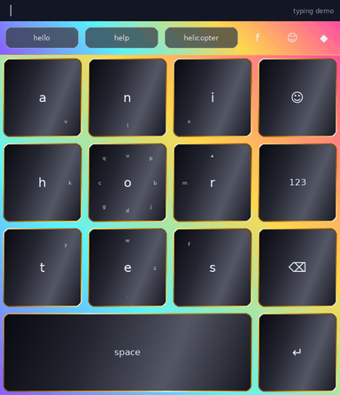
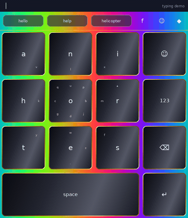
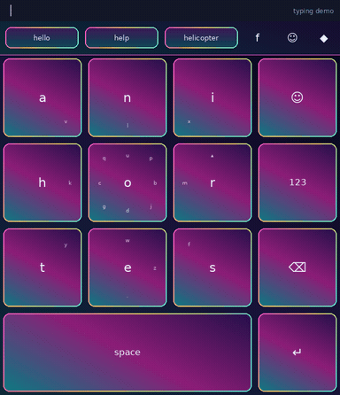
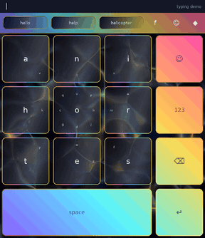

# Keywi Themes

Optional, premade Keywi themes. **Your local theme library stays where it is. Explore is an additional online catalog. Download installs a named local entry; only an explicit Apply action changes the keyboard.**

The starter catalog contains **Birdie Rainbow**, **Sinebow**, **Neon Aviary**, and **OilSlyck**. Theme packages are self-contained `.keywi-theme.zip` files; listings carry separate animated keyboard previews and still thumbnails.

| Birdie Rainbow | Sinebow |
| --- | --- |
|  |  |
| [Download](themes/birdie-rainbow/birdie-rainbow-1.0.0.keywi-theme.zip) | [Download](themes/sinebow/sinebow-1.0.0.keywi-theme.zip) |

| Neon Aviary | OilSlyck |
| --- | --- |
|  |  |
| [Download](themes/neon-aviary/neon-aviary-1.0.0.keywi-theme.zip) | [Download](themes/oilslyck/oilslyck-1.0.0.keywi-theme.zip) |

## For Explore

Use [`catalog.json`](catalog.json), or this direct URL:

```text
https://raw.githubusercontent.com/BirdMachine/keywi-themes/main/catalog.json
```

Resolve relative package and preview URLs against the catalog URL. Prefer thumbnails in the grid and load the GIF on the detail page. Downloads have fixed versioned filenames, SHA-256 digests and byte sizes. Adding a catalog entry does not require republishing the APK.

The catalog format is specified in [`docs/catalog-format.md`](docs/catalog-format.md). [`docs/explore-integration.md`](docs/explore-integration.md) describes download/install/apply separation and compatibility requirements. **This repository prepares content; it does not yet add the Explore button to the app.**

## Key groups are part of themes

Schema-3 theme documents include `keys.keyGroups`, per-key `keyOverrides`, and shared-gradient canvas settings. Group designs can contain surface/border colors or gradients and a glyph color. The original OilSlyck `MainTools` group is retained, including all five positional key IDs, its shared canvas, both gradients, and glyph color.

These IDs identify visual positions, not semantic actions: another layout or facet may place different keys at those positions. Theme geometry and content layout remain independent. These previews use square ME-Like geometry and English MessagEase legends; border width and radius are documented preview settings, not imported theme properties.

The previews are **rendered demonstrations**, not emulator captures. They show synthetic typing of “hello” followed by deletion, and include the theme's animated background where present. They use current source definitions and group-canvas rules. Exact device fonts, active palette, geometry, press animation and power mode may differ.

## Packages and source

Each folder in `themes/` contains:

- `theme.json`: editable source manifest.
- `<id>-1.0.0.keywi-theme.zip`: current import-compatible package.
- `entry.json`: the listing metadata duplicated in the aggregate catalog.
- `preview.gif`: looping rendered keyboard demo.
- `preview.png`: larger still preview.
- `thumbnail.png`: smaller grid image.

Previews stay outside the downloadable theme ZIP: browsing remains lightweight and packages retain their existing import format. Every listing contains a GIF preview URL.

OilSlyck was copied from Birdie's export. Only its catalog identity, display name and a `.bin`→`.gif` media filename were normalized. All appearance settings and the original GIF bytes are retained. The upload is not changed. Source details are recorded in `provenance/`.

Birdie Rainbow is the app's default Custom baseline captured as a named preset; Sinebow packages the existing backdrop preset with the same standard key/toolbar settings. Neon Aviary follows the named built-in theme. Definitions were checked against Keywi commit [`232070c`](https://github.com/BirdMachine/Keywi/commit/232070cbde42c9e7c893874bc50e2145140609b9). These are distinct catalog IDs, so a downloaded entry cannot silently collide with `custom` or a built-in ID.

## Validate and rebuild

```bash
python tools/validate_catalog.py
```

Validation uses Python's standard library. Rebuilding starter packages with `tools/seed_catalog.py` additionally requires the original OilSlyck upload. Rendering GIF previews with `tools/render_previews.py` requires Pillow, NumPy, ffmpeg and the system DejaVu Sans font. After editing themes, increment their version and revision, then regenerate sizes/digests and previews before publishing. Do not overwrite a published version's package contents.

License fields are currently unset (`null`); no new media license is asserted by catalog packaging.
